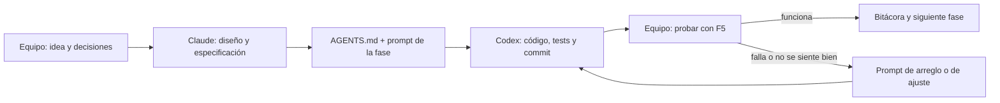

# VoodooCombo — Plan del DevChallenge3

> Documento guía del equipo: qué pide el enunciado, cómo lo cumplimos, cómo trabajamos con la IA y cómo lo vamos a presentar.

## 1. El proyecto en 3 líneas

**VoodooCombo** es un party game multijugador en red, de 2 a 4 jugadores, hecho con **Godot 4**.
Cada jugador es un muñeco vudú que recoge doblones en una arena aleatoria, encadena combos y golpea con el dash para robar.
Todo el desarrollo se ha hecho con agentes de IA: **Claude** para el diseño y la especificación, y **Codex** para el código.

---

## 2. Matriz de requisitos del enunciado

| Requisito | Cómo lo cumplimos | Cómo se demuestra |
|---|---|---|
| Más de un jugador | De 2 a 4 jugadores en red (ENet) | Demo con 2 PCs |
| Login (opcional) | Sin login: nick, color, forma (● ▲ ■ ◆) y "Jugador N" | Sala de espera |
| Sala de espera / master | Lobby. El anfitrión es el master: elige modo y duración y pulsa Empezar | Demo |
| Cada jugador sabe qué jugador es | "Jugador N" en la sala, "¡Eres el Jugador N!" con flecha al empezar, forma propia | Demo |
| Tablero aleatorio | Arena generada con semilla en cada partida: bioma, obstáculos simétricos y 50 doblones | Dos partidas seguidas dan dos arenas distintas |
| Los jugadores aparecen en algún punto | Salidas al azar (esquinas o centros de los lados) | Demo |
| Conseguir un objetivo | **Modo Clásico:** el primero en recoger 15 de los 50 doblones (el ejemplo del enunciado). **Modo VoodooCombo:** tener más doblones a los 90 s | Partida en cada modo |
| Cada jugador en su máquina | Unirse por IP o desde la lista de la red local. Servidor dedicado opcional | Demo con 2 PCs |
| Protocolo asíncrono | Mensajes RPC de ENet sobre UDP: no fiables para posiciones y fiables para eventos | Diagrama en la presentación |
| Endpoint que gestiona la partida y devuelve el ganador | El servidor autoritativo decide el ganador y lo envía a todos (`match_over`). Endpoint HTTP con `GET /status`, `GET /results` y `GET /` (marcador en directo) | Abrir `http://IP:8080/` en el navegador durante la demo |
| Guardar partidas (opcional) | JSON en `user://matches/` y pantalla Historial | Historial |
| Estética | Identidad vudú, paleta con contraste, juice, sonido sintetizado | Vídeo o GIFs |
| Usabilidad | 3 controles, "Cómo se juega" en 3 iconos, LAN automática, revancha en 1 clic | Demo |
| Accesibilidad | Nunca solo color (formas), teclado y mando, reducir movimiento, escala de UI, ca/es/en | Ajustes |
| **Desarrollo con agentes de IA** | Claude y Codex con un flujo definido (§3) | `docs/HISTORIA-IA.md`, `docs/BITACORA.md` y conversaciones |
| **Documentación y exposición** | Bitácora durante el trabajo, investigación propia y presentación esquemática | `docs/` y la presentación |

---

## 3. Herramientas de IA y flujo de trabajo

| Herramienta | Para qué la usamos | Cómo le damos las directrices |
|---|---|---|
| **Claude** | Ideas y diseño del juego, iteraciones de diseño, especificación (`AGENTS.md`), prompts por fases, revisión del código del repo, documentación y presentación | Conversación (se exporta a `docs/conversaciones/`) |
| **Codex** | Programar el juego en Godot fase a fase, tests y commits | `AGENTS.md` (directrices permanentes que lee solo) + un prompt corto por fase (`docs/PROMPTS-CODEX.md`) |

> En la presentación, poned la herramienta y el modelo que uséis **de verdad** (Codex y Claude lo muestran en pantalla).

**Reparto (propuesta, ajustadlo):**

| Quién | Qué |
|---|---|
| Miquel | Diseño con Claude, `HISTORIA-IA.md`, `INVESTIGACION.md`, pruebas de juego y presentación |
| Compañero | Repo, Codex fase a fase, exportar el juego |
| Los dos | Probar cada fase, rellenar la bitácora, investigar cada uno 2-3 tecnologías y presentar |

---

## 4. Hitos

| Hito | Fases de Codex | Está listo cuando… |
|---|---|---|
| **H0 · Repo preparado** | — | Misma versión de Godot en los dos PCs, el kit subido al repo, Godot en el PATH y Codex funcionando |
| **H1 · Divertido en local** | 0-2 | Partida completa contra bots en los dos modos |
| **H2 · Multijugador** | 3 | Partida entre 2 PCs **en la red del instituto** y `/results` abierto en el navegador |
| **H3 · Dopamina y estética** | 4-5 | Todo el feedback de `AGENTS.md` §6, los biomas y los menús |
| **H4 · Completo** | 6-7 | Podio, historial, personalización y accesibilidad |
| **H5 · Entrega** | 8 | README, ejecutable de Windows, bitácora cerrada, presentación y vídeo de respaldo |

> **Llegad pronto a H2.** La red del instituto es el mayor riesgo (§8): mejor descubrirlo con margen.

---

## 5. Documentar mientras trabajáis

**Dónde queda la respuesta a cada pregunta del profesorado:**

| Pregunta | Dónde está la respuesta |
|---|---|
| Qué herramientas de IA habéis usado | §3 de este documento y la portada de la presentación |
| Qué idea tuvisteis y cómo se la pedisteis al agente | `HISTORIA-IA.md` y `AGENTS.md` |
| Qué prompts usasteis y qué respondió | `PROMPTS-CODEX.md`, conversaciones exportadas y ⭐ de la bitácora |
| Si investigasteis alguna tecnología | `INVESTIGACION.md` |
| Si los primeros resultados funcionaron y qué reformulasteis | Tabla humana de `BITACORA.md` |

**Hábitos:**
1. **Después de cada fase,** 5 minutos para la tabla humana de la bitácora. Al final del proyecto ya no os acordaréis.
2. **Marcad con ⭐** los momentos que queráis enseñar en la presentación.
3. **Una captura o un GIF de 10 s por fase** en `docs/capturas/`. Sirve la herramienta Recortes de Windows, que graba vídeo, o ScreenToGif.
4. **Exportad las conversaciones** al acabar cada sesión (`docs/conversaciones/README.md`).
5. **No copiéis respuestas de la IA.** Contad *qué propuso → qué decidimos → por qué*.
6. **Apuntad solo errores reales.** El PDF de especificación del principio traía una "bitácora de errores" con fallos que todavía no habían pasado y nombraba un modelo concreto. No lo presentéis como real: sustituidlo por lo que os pase de verdad.

---

## 6. Investigación propia

El profesorado pregunta si investigasteis las tecnologías o si copiasteis lo que propuso la IA. Para cada tecnología de `INVESTIGACION.md`:
- explicadla con vuestras palabras,
- haced un pequeño experimento,
- y apuntad la fuente oficial.

---

## 7. Presentación (guion esquemático)

1. **Portada:** VoodooCombo, el equipo y las herramientas de IA.
2. **El juego en una frase** + GIF de 10 s.
3. **Enunciado → cómo lo cumplimos:** la matriz de §2 resumida.
4. **Cómo hemos trabajado con la IA:** el diagrama de §3 y quién hace qué.
5. **De la primera idea al juego final:** la línea de tiempo de las iteraciones (`HISTORIA-IA.md`). Es el punto fuerte: hacia dónde nos llevó la IA y qué decidimos nosotros.
6. **Prompts clave:** 3 o 4 destacados, resumidos, con lo que nos dio cada uno.
7. **Arquitectura:** cliente-servidor, mensajes fiables y no fiables, endpoint (diagrama).
8. **Qué investigamos nosotros:** ENet, interpolación, `TCPServer`, generación con semilla.
9. **Qué falló y cómo lo reformulamos:** 2 o 3 casos reales con el antes y el después.
10. **Estética, usabilidad y accesibilidad:** capturas.
11. **Demo en directo:** partida en 2 PCs y `/` en el navegador. Plan B: el vídeo.
12. **Conclusiones:** qué haríamos diferente trabajando con la IA.

---

## 8. Demo y riesgos

| Riesgo | Cómo prevenirlo | Plan B |
|---|---|---|
| La red del instituto bloquea las conexiones entre PCs o el broadcast | Probadlo en clase en cuanto lleguéis a H2 | Punto de acceso del móvil o router propio. Unirse por IP |
| El firewall de Windows bloquea el juego | La primera vez que se abre, permitirlo en redes privadas | Añadir la excepción a mano |
| Versiones distintas del juego en cada PC | Comprobación de versión al unirse y el mismo ejecutable en todos | — |
| Algo falla en directo | Vídeo de 60 s de una partida real grabado de antemano | Varias instancias en un mismo PC |
| El proyector se ve pequeño o con poco contraste | Escala de UI al 125 % y probar antes | — |

---

## 9. Checklist de entrega

- [ ] Se puede jugar entre 2 o más PCs
- [ ] Sala de espera con master y cada jugador sabe qué jugador es
- [ ] Arena aleatoria. El modo Clásico (15 de 50) funciona
- [ ] El endpoint muestra el ganador (`/results` y `/`)
- [ ] Partidas guardadas e Historial
- [ ] Estética, usabilidad y accesibilidad repasadas (`AGENTS.md` §6-8)
- [ ] README con instrucciones y ejecutable de Windows
- [ ] `BITACORA.md` completa (parte de Codex y parte humana)
- [ ] `HISTORIA-IA.md` e `INVESTIGACION.md` rellenados
- [ ] Conversaciones exportadas en `docs/conversaciones/`
- [ ] Presentación y vídeo de respaldo
